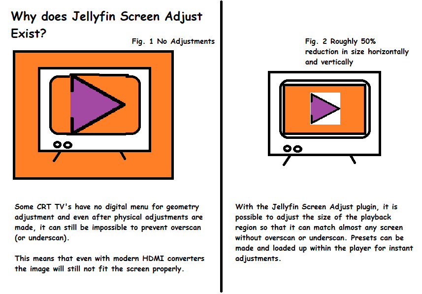
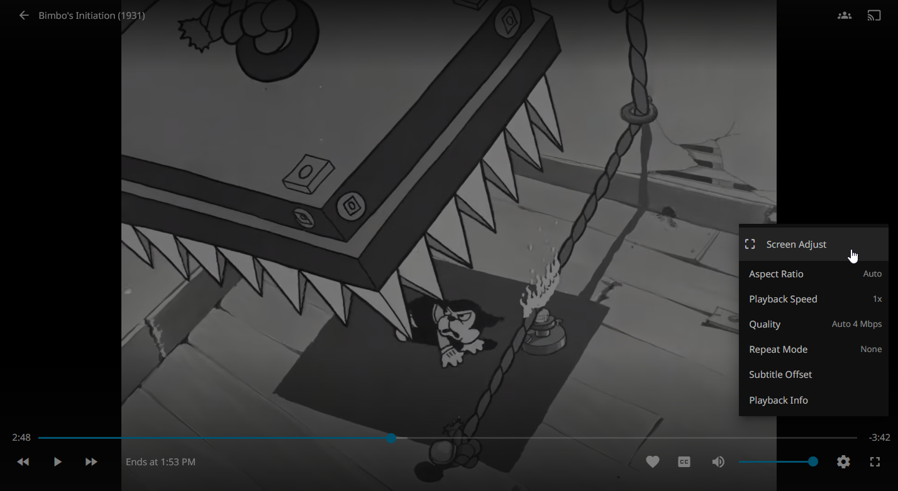
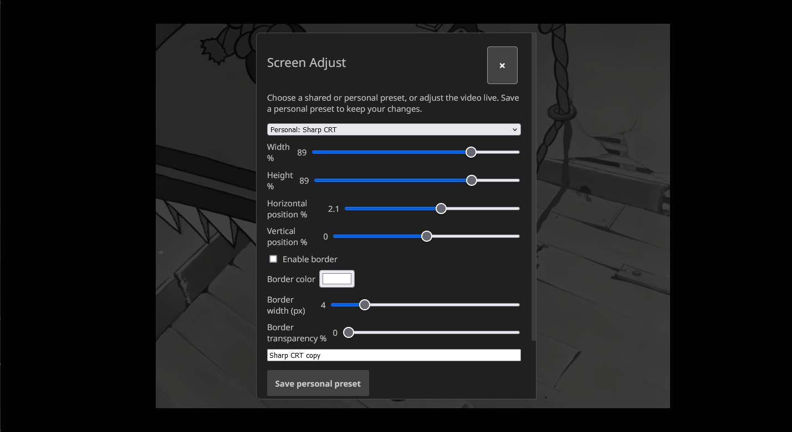

# Jellyfin Screen Adjust

**Author:** Full_Quantum

A Jellyfin Web plugin that lets each user adjust the **playback region (size and position) of the video player** and save the result as **presets**. It was built primarily for **finicky CRT TVs with overscan**, where the edges of the picture are cut off and the video needs to be shrunk or nudged to fit the visible screen.

> ⚠️ **Requires the JavaScript Injector plugin.** Screen Adjust has no player controls without it. See [Prerequisites](#prerequisites).

- Live size and position adjustment during playback (position in 0.1% steps)
- Personal presets per user, plus shared presets available to everyone (Default 100%, 50%, 75%, 85%)
- Opened from the cog wheel in the bottom-right of the Jellyfin Web video player
- Alt+Shift+S shortcut for personal preset management

> Works in **Jellyfin Web** (browsers, and wrappers that load Jellyfin Web). It does not change native Jellyfin clients.

## Why Screen Adjust exists

Some CRT televisions have no geometry controls, or their adjustments cannot fully compensate for overscan or underscan. This illustration shows how Screen Adjust can shrink the playback region to better fit the visible screen; presets make those adjustments easy to reuse.



## Screenshots

The first screenshot shows where to open Screen Adjust from the playback settings cog. The second shows the adjustment dialog and its preset, sizing, positioning, and border controls.





## Prerequisites

| Requirement | Notes |
|---|---|
| Jellyfin Server **10.11+** (ABI 12.3.0 / .NET 10 build) | Built against `Jellyfin.Controller` 12.3.0 |
| [**JavaScript Injector**](https://github.com/n00bcodr/Jellyfin-JavaScript-Injector) plugin | **Required.** Screen Adjust registers its player controls through it automatically. Install and enable it first. |

> ⚠️ **Warning:** without JavaScript Injector installed *and enabled*, Screen Adjust will appear in the plugin list but the cog-wheel menu entry will never show up. Jellyfin Web clients only (including browsers and wrappers that load Jellyfin Web); native apps are unaffected.

JavaScript Injector is available from its own plugin repository; follow its README to add that repository in *Dashboard → Plugins → Repositories*, install it, and restart Jellyfin. Screen Adjust logs a message and its player controls will not appear if JavaScript Injector is missing.

## Installation

### Option A – Plugin repository (recommended)

1. In Jellyfin: *Dashboard → Plugins → Repositories → Add*.
2. Add: `https://raw.githubusercontent.com/Full-Quantum/jellyfin-plugin-screenadjust/main/manifest.json`
3. Open the *Catalog*, install **Screen Adjust**, and restart Jellyfin.

### Option B – Manual

1. Download `Jellyfin.Plugin.ScreenAdjust_1.0.25.0.zip` from the [Releases](../../releases) page.
2. Extract the DLL into a new folder `ScreenAdjust` inside the Jellyfin `plugins` directory.
3. Restart Jellyfin.

Then make sure **JavaScript Injector is installed and enabled**, and hard-refresh Jellyfin Web (Ctrl+F5).

## Usage

1. Start playing a video in Jellyfin Web.
2. Click the cog wheel at the bottom right of the player and choose **Screen Adjust**.
3. Pick a shared or personal preset, or adjust size/position live.
4. Save a personal copy, delete a personal preset, or reset to full-size centered playback.

## Building from source

Requires the .NET 10 SDK.

```powershell
dotnet build Jellyfin.ScreenAdjust.csproj --configuration Release
```

The output is `bin\Release\net10.0\Jellyfin.Plugin.ScreenAdjust.dll`. The browser script (`client/ScreenAdjust.user.js`) is embedded in the DLL. Zip the DLL at the archive root to produce a release, and update `checksum` (MD5) in `manifest.json` to match.

## Changelog

- **1.0.25.0** – The player settings menu no longer jumps/repositions on mouse-over; it is placed statically above the playback bar and shows all entries.
- **1.0.24.0** – Uses Jellyfin Web authorization headers for profile requests.

## License

MIT – see [LICENSE](LICENSE). © 2026 Full_Quantum.
